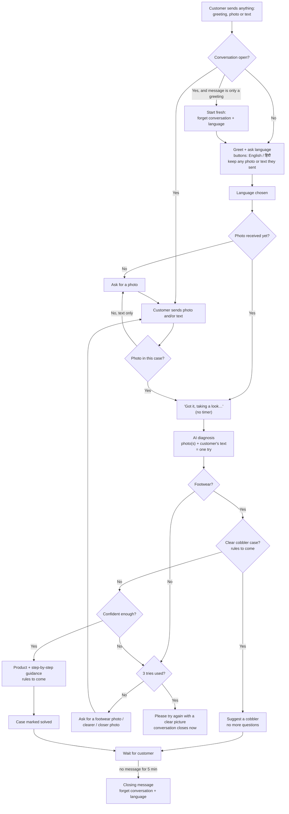

# Customer journey

*Agreed 3 Nov 2026, **built 3 Nov 2026** (branch `rishabh/user-journey`). It is based on the team's flow diagram
and the decisions below. Parts marked **rules to come** use a placeholder until the team's rules arrive.*

Related: [PROJECT_LOG.md](../PROJECT_LOG.md) (decisions and status), [DESIGN.md](DESIGN.md) (how the bot works,
which file does what). Settings: `conversation.*` and `records.*` in `config/settings.yaml`.

---

## 1. The flow at a glance

The 5-minute timer is drawn only at the end to keep the chart readable, but it runs after **every** real
answer or question from the bot, including "please send a photo" and "please send a closer photo".

## 2. Step by step

1. **First contact.** The customer may say hi, or send a photo or text straight away. Either way, if no
   conversation is open, the bot greets them and asks for their language with two buttons: **English / हिंदी**.
   The message also says they can change the language at any time by typing "English" or "Hindi".
   Anything they already sent (photo or text) is kept and used once the language is chosen. They don't have to
   send it again.
2. **Language chosen.** If a photo is already there, the bot goes straight to the diagnosis. If not, it asks for a
   photo ("Please send a photo of the footwear that needs fixing."). Text they type is still read and used.
3. **Customer describes the problem.** Photos and text are both used. Text in English, Hindi or Hinglish is
   understood. Replies are always in the chosen language, and Hindi replies use Hindi letters (Devanagari).
   Text with no photo yet → the bot asks for a photo. The text is kept and goes to the model with the photo.
4. **"Got it, taking a look…"** goes out when a photo arrives (diagnosis takes about 40 s). This is a "please wait"
   message and does not start the 5-minute timer.
5. **Diagnosis.** The model gets every photo and every piece of text in the current case, and fills in the
   10 fields as today. Each diagnosis counts as **one try**. Photos sent within 6 s of each other still count as
   one item, so they are one try.
6. **Not footwear** → the bot asks for a photo of the footwear that needs fixing. It never says the query is
   "not valid". This counts as a try.
7. **Clear cobbler case** (**rules to come**) → the bot suggests a cobbler and does **not** ask for more photos,
   even if it is unsure about a small detail such as the material.
8. **Not confident enough** (blurry, no damage visible, unsure about something that decides the fix) → the bot
   asks for a clearer or closer photo. The new photo is **added to the same case**, not treated as a new one.
9. **3 tries without a confident answer** → "Please try again with a clear picture." The conversation **closes
   immediately**, with no separate closing message. All tries count, including blurry and not-footwear photos.
10. **Confident** → product recommendation and step-by-step guidance in the chosen language
    (**rules to come**; until then a placeholder). Once the steps are sent, the case is marked **solved**.
11. **Waiting for the customer.** The 5-minute timer runs after every real answer or question from the bot.

## 3. Conversation rules

| Rule | Decision |
|---|---|
| Languages | English and Hindi. Hindi replies in Hindi letters. Hinglish (or Hindi) typed by the customer is understood and answered in the chosen language. |
| Memory | The bot remembers the open conversation: language, photos, text, tries, diagnoses. |
| 5-minute timer | Starts after the bot's **real** reply (an answer or a question). "Please wait" messages ("Got it, taking a look…") don't start it. If the customer sends nothing for 5 min, the conversation closes. |
| Closing | The bot sends a closing message in the chosen language, then forgets the conversation **and** the language. The next message starts again with the language question. |
| After 3 failed tries | "Please try again with a clear picture", then the conversation closes immediately (no extra closing message). |
| Fresh start | A message that is **only** a greeting (hi, hii, hello, hey, namaste, नमस्ते; any capitals or punctuation) starts a new conversation. Messages like "hi, my strap is broken" are not handled specially for now: they are treated as a normal message. |
| Customer comes back later | If they come back after the conversation closed (for example 20 min later after gluing), it's a new conversation. Accepted for now. |
| Solved | A case counts as solved once the repair steps have been sent. |
| After the answer | After the repair steps or a cobbler suggestion, the conversation **stays open** (usual 5-minute close). The bot does **not** answer free questions yet ("which glue did you say?", "can I use it on leather?"): it points back to the steps already sent and asks for a photo if there is another problem. Answering free questions may come later with the solution rules. |
| Choosing / changing language | Tapping a button, or typing English / Hindi / हिंदी, sets the language. Typing one of these **at any point** in the conversation switches to it, but only when the message is just the language name ("Hindi", "hindi", "हिंदी"); a sentence like "I don't understand Hindi well" does not switch it; the case is kept and replies continue in the new language. Anything else while waiting for a language → ask again. |
| Typing "language" / "भाषा" | Shows the two language buttons again with a short message in the language of the word typed: "language" → "🌐 Change language", "भाषा" (also "bhasha") → "🌐 भाषा बदलें". Only when the message is just that word. Works at any point, including before a language is chosen. Nothing changes until a button is tapped; not a try. |
| Another photo while the bot is still checking | Added to the same case; **not** an extra try. |
| Only text after the bot asked for a closer photo | The bot tries again using the photos it already has **plus** the new text. This **counts as a try**. If that is enough, it answers; if not, it asks for a photo again. |
| Voice note or video | "Sorry, I can't open voice notes or videos yet. Please send a photo of the footwear." This **counts as a try**. |
| What counts as a try | Every diagnosis (a photo or group of photos, or a text-only retry on existing photos), including blurry / not footwear / no damage visible, **and** every voice note or video. Text sent before any photo (asked for a photo) and a photo sent while the bot is still checking do not count. |
| Off-topic text ("what's your name?") | Ask for a photo of the footwear that needs fixing. |
| Records | Testing: saved, one case per conversation. Real customers: everything deleted when the conversation closes (only cost numbers kept). An on/off setting. See section 6. |

## 4. Messages the customer can receive (English and Hindi, in `app/replies.py`)

| Moment | Purpose |
|---|---|
| Greeting + language question | Welcome, ask English / हिंदी (two reply buttons); say they can type "English" or "Hindi" any time to change |
| Change language | "🌐 Change language" / "🌐 भाषा बदलें" + the two buttons, after the customer types "language" / "भाषा" |
| Language changed | Confirms the switch, in the new language |
| Ask for a photo | After language is chosen, when no photo yet; also for text-only messages |
| Got it, taking a look… | Photo received, diagnosis started (no timer) |
| Ask for a footwear photo | The photo doesn't show footwear |
| Ask for a clearer photo | Blurry / dark |
| Ask for one item | More than one different item in the photo |
| Ask for a close-up of the problem | No damage visible, or not confident |
| Suggest a cobbler | Clear cobbler case (rules to come) |
| Product + step-by-step guidance | Confident diagnosis (rules to come) |
| Please try again with a clear picture | After 3 tries; closes the conversation |
| Closing message | 5 min without a reply |
| After the answer | Customer writes after the steps / cobbler suggestion: points back to the steps, asks for a photo if there is another problem |
| Can't open voice notes or videos | "Sorry, I can't open voice notes or videos yet. Please send a photo of the footwear." (counts as a try) |
| Can't open that kind of message | Stickers, documents, locations etc. |
| Something went wrong | Technical error |

All of these are written in both languages in `app/replies.py`. The Hindi wording should be checked by a Hindi
speaker on the team before going live.

## 5. Built vs to build

| Part | Status |
|---|---|
| Photo diagnosis (10 fields + confidence) | Built |
| Language question (buttons) + English/Hindi replies + typing a language name to switch | Built |
| Understanding Hinglish / Hindi text, using the customer's text in the diagnosis | Built (prompt `diagnosis_v2`) |
| Conversation memory (photos and text added to the same case, tries counted) | Built |
| "Got it, taking a look…" message | Built |
| 5-minute timer + closing message | Built: the bot checks every 15 s (`conversation.check_every_seconds`) |
| Greeting = fresh start | Built |
| 3-try limit, voice notes / videos counted | Built |
| Marking a case solved | Built (`cases.outcome`) |
| Saving on/off setting; delete a closed conversation when off; keep cost numbers only | Built (`records.keep_after_close`) |
| One case per conversation in saved records | Built (`cases` table; `case_id` on messages, photos, diagnoses) |
| Cobbler step | Built with a **placeholder rule** (below); waiting for the team's rules |
| Product + step-by-step guidance (with pictures) | Placeholder line in the answer; waiting for rules and content |
| Hindi wording | Written; to be checked by a Hindi speaker |

Everything above is possible on real WhatsApp (reply buttons, text, photos with captions, messages within the
24-hour window), so nothing here works only in the simulator.

### Decided while building (small choices, easy to change)

- **Cobbler placeholder:** until the rules arrive, a clear cobbler case is a confident Glue Fix Possible of
  "No – Weight-Bearing Part", "No – Material Destroyed" or "No – Surface Glue Cannot Hold" (`is_cobbler_case()`
  in `app/core/rules.py`). The bot already said "take it to a cobbler" for these before.
- **Product placeholder:** a confident answer ends with "[Product recommendation and step-by-step guidance will
  be added here.]" so nobody mistakes it for the finished reply.
- **Bad photos are left out of later tries:** photos judged blurry, not footwear or more than one item are not
  sent to the model again in the same conversation (they would confuse the next look).
- **A photo after the answer** ("send a photo if there's another problem") starts a new case in the same
  language, with tries starting again. Text after the answer gets "my answer is in the message above…".
- **A voice note or video after the answer** gets the "can't open these" reply but doesn't count as a try.
- **Our own failures don't count as tries:** if the model call fails, the customer gets "something went wrong,
  please send it again" and keeps the try.
- **A photo or text sent while the bot is still checking** is added, and the bot looks again before replying
  (one reply, same try).
- **A photo with a caption:** the caption counts as the customer's text.
- **After a restart** of the bot, open conversations are kept; one whose reply was being prepared starts its
  5-minute timer from the restart.

## 6. Records (decided 3 Nov 2026)

Saving is a setting, `records.keep_after_close` in `config/settings.yaml`: `auto` (the default: on in simulator
mode, off in whatsapp mode), `true` or `false`. It can be switched back on later without rebuilding anything.

| | Testing (simulator) | Real customers (WhatsApp) |
|---|---|---|
| Saving | **On** | **Off** |
| While a conversation is open | Photos, text, diagnoses, replies kept (the bot needs them to add a second photo to the same case) | Same |
| When the conversation closes | Kept, as **one case per conversation** (all photos, tries and the final answer together), so the team can check how the model did | **Deleted:** photos (files too), text, diagnoses, replies, the customer's name. Only bare message ids stay (no content, no number), so a late duplicate delivery from WhatsApp is still recognised. |
| Dashboard (port 8001) | Shows the latest diagnosis, as today | Shows a case only while its conversation is open; blank after it closes |
| Cost of each model call | Kept | **Only the numbers are kept** (cost, tokens, model), with no photos, text or phone number, so models can still be compared on cost |

- Model checking does not depend on customer records: it uses the team's separate labelled photo dataset.
- This replaced the earlier rule "the full history stays in `data/bot.db` for model evaluation" (CLAUDE.md,
  DESIGN.md and PROJECT_LOG.md were updated when it was built).
- If saving for real customers is switched on later, decide first how long records are kept and how to delete
  them on request: phone numbers and photos are personal data, and India's DPDP Act applies. Pidilite's legal
  team should confirm.

## 7. Not in this phase

- **Reviewer** (a person who checks unsure cases): skipped for now. The 3-try limit replaces it.
- **"Did this help?" question** after the steps: skipped. Sending the steps = solved.
- **Greeting + problem in one message** ("hi, my strap is broken"): not handled specially yet.
- **Voice notes and video:** later.

## 8. Waiting on

- Rules for **"too extensive" / cobbler cases**.
- Rules for **which product and which steps** for each problem, plus the step pictures.
- **Hindi wording** check by a Hindi speaker.
